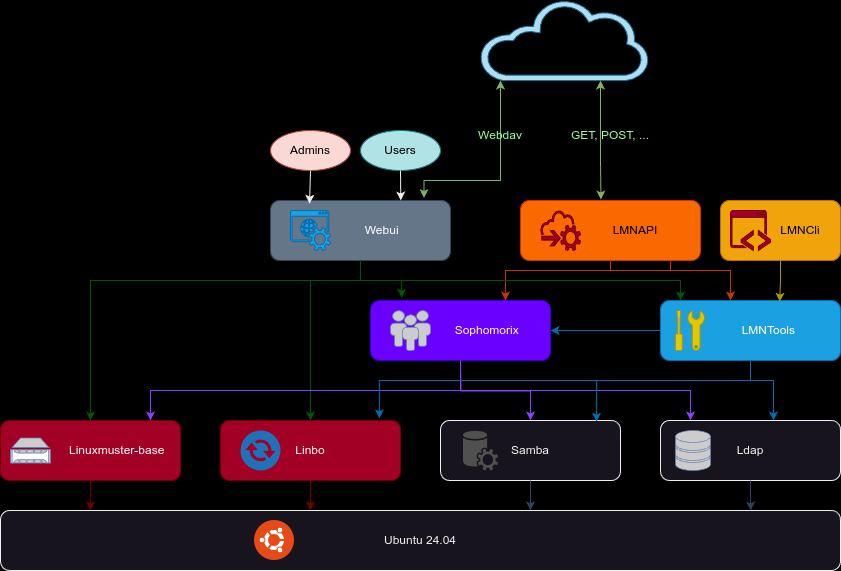

<p align="center">
   
</p>

<p align="center">
  <a href="https://github.com/linuxmuster/deb/actions/workflows/build-and-deploy.yml"></a>
  <a href="https://ask.linuxmuster.net"></a>
  <a href="https://www.gnu.org/licenses/agpl-3.0" ></a>
</p>

<p align="center">
This is the Linuxmuster.net archive. It is the place where you can get the latest versions of all Linuxmuster.net software.
</p>

# Packages
This repo currently contains the following packages:
- [leoclient2](https://github.com/linuxmuster/leoclient2) (lmn71-testing)
- [base7](https://github.com/linuxmuster/linuxmuster-base7) (lmn71,lmn72,lmn73,lmn74)
- [linbo-gui7](https://github.com/linuxmuster/linuxmuster-linbo-gui7) (lmn71,lmn72,lmn73,lmn74)
- [linbo](https://github.com/linuxmuster/linuxmuster-linbo7) (lmn71, lmn71-testing,lmn72,lmn73,lmn74)
- [linuxmuster-linuxclient](https://github.com/linuxmuster/linuxmuster-linuxclient7) (lmn71,lmn72,lmn73)
- [linuxmuster-prepare](https://github.com/linuxmuster/linuxmuster-prepare) (lmn71,lmn72,lmn73,lmn74)
- [linuxmuster-webui](https://github.com/linuxmuster/linuxmuster-webui7) (lmn71, lmn72,lmn73,lmn74)
- [sophomorix](https://github.com/linuxmuster/sophomorix4) (lmn72,lmn73,lmn74)
- [linuxmuster-tools](https://github.com/linuxmuster/linuxmuster-tools) (lmn72,lmn73,lmn74)
- [linuxmuster-cli](https://github.com/linuxmuster/linuxmuster-cli7) (lmn72,lmn73,lmn74)
- [linuxmuster-api](https://github.com/linuxmuster/linuxmuster-api) (lmn72,lmn73,lmn74)
- [linuxmuster-common](https://github.com/linuxmuster/linuxmuster-common) (lmn73,lmn74)
- [linuxmuster-fileserver](https://github.com/linuxmuster/linuxmuster-fileserver) (lmn73,lmn74)
  
# Setup

To use the repository, please follow these steps:

## 1. Import key:

```bash
wget -qO- "https://deb.linuxmuster.net/pub.gpg" | sudo gpg --dearmour -o /usr/share/keyrings/linuxmuster.net.gpg
```

## 2. Add repo:

### Linuxmuster 7.4
```bash
sudo sh -c 'echo "deb [arch=amd64 signed-by=/usr/share/keyrings/linuxmuster.net.gpg] https://deb.linuxmuster.net/ lmn74 main" > /etc/apt/sources.list.d/lmn74.list'
```

## 3. Apt update

```bash
sudo apt update
```

# Installing a specific version

This repository only serves the **latest** version of each package per distribution
(`apt policy <package>` lists a single version). If you really need an older version
(e.g. to roll back after a regression), every released `.deb` is attached to the
GitHub release of its project:

1. Open the releases page of the project (see the package list above), e.g.
   https://github.com/linuxmuster/linuxmuster-tools/releases
2. Pick the version you need, check that it was built for your distribution (most
   release titles show it, e.g. `Release 7.4.19 (lmn74)`), and download the `.deb`:

   ```bash
   wget https://github.com/linuxmuster/linuxmuster-tools/releases/download/v7.4.19/linuxmuster-tools7_7.4.19_all.deb
   ```
3. Install it and keep apt from upgrading it again:

   ```bash
   sudo apt install ./linuxmuster-tools7_7.4.19_all.deb
   sudo apt-mark hold linuxmuster-tools7
   ```
4. Once the problem is fixed upstream, release the hold:

   ```bash
   sudo apt-mark unhold linuxmuster-tools7 && sudo apt upgrade
   ```

# Linuxmuster.net packages interaction

A quick view over the interaction between all packages when installed on the server:

<p align="center">
   
</p>
